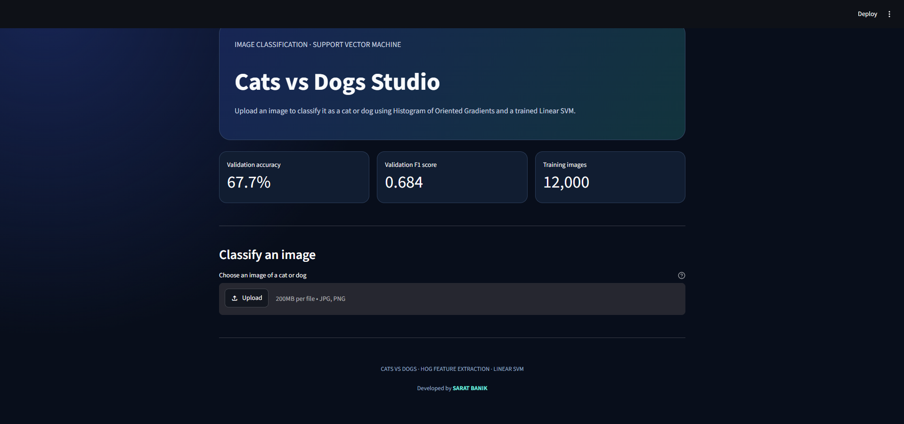
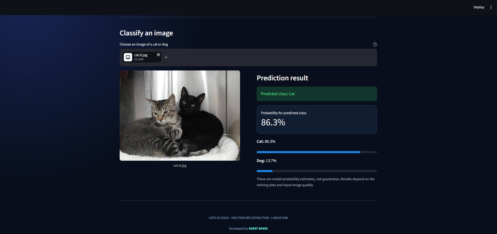
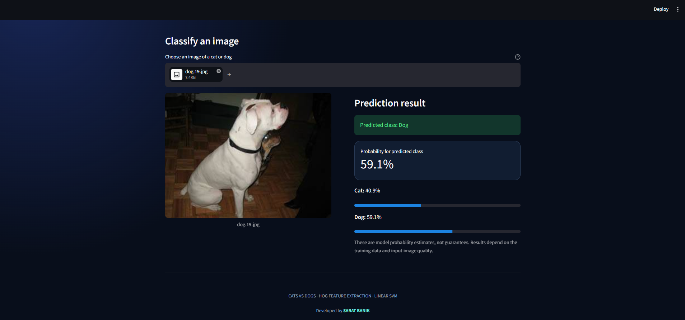

# Cats and Dogs Image Classification Using SVM

An image-classification project that distinguishes cats from dogs using **Histogram of Oriented Gradients (HOG)** feature extraction and a **Linear Support Vector Machine (SVM)**.

The project includes image preprocessing, model training, validation, an interactive Streamlit application, and test-set prediction generation.

## Project Highlights

- Cat and dog image classification using SVM.
- HOG-based visual feature extraction.
- Image preprocessing and grayscale resizing.
- Model evaluation using accuracy, F1 score, and a confusion matrix.
- Interactive image prediction through Streamlit.
- Command-line prediction for individual images.
- Optional Kaggle-format test predictions.

## Application Screenshots

### 1. Dashboard Overview

The main interface displays validation metrics and provides an image upload option for classification.



### 2. Cat Image Prediction

Upload a cat image to view the predicted class and estimated probabilities for both classes.



### 3. Dog Image Prediction

The application also classifies dog images and displays the prediction and probability estimates.



## Technology Stack

- **Language:** Python
- **Machine Learning:** scikit-learn, Linear SVM
- **Feature Extraction:** HOG, scikit-image
- **Image Processing:** Pillow
- **Data Handling:** NumPy and pandas
- **Visualization:** Matplotlib
- **User Interface:** Streamlit

## Dataset

This project uses the Dogs vs. Cats image-classification dataset.

[Kaggle — Dogs vs. Cats Redux: Kernels Edition](https://www.kaggle.com/competitions/dogs-vs-cats-redux-kernels-edition/data)

Place the extracted training folders and test files in the following structure:

```text
data/
└── raw/
    ├── train1/
    ├── train2/
    ├── test.zip
    └── sample_submission.csv
```

Training filenames should identify their class, such as `cat.0.jpg` and `dog.0.jpg`, or the images should be arranged in class-specific folders.

The raw dataset is not included in this public source repository. Download it from Kaggle and follow the project folder structure.

## Installation

Create a virtual environment from the project root:

```powershell
py -m venv .venv
.\.venv\Scripts\Activate.ps1
```

Install the required libraries:

```powershell
python -m pip install --upgrade pip
pip install -r requirements.txt
```

## Train the Model

Run:

```powershell
python train_model.py
```

By default, the training script uses a balanced sample of up to 12,000 images. To use all available labeled images, run:

```powershell
python train_model.py --max-images 0
```

Using all images may require more processing time and memory.

## Run the Application

After training completes, launch the Streamlit application:

```powershell
streamlit run app.py
```

Open the local URL shown in the terminal, usually `http://localhost:8501`.

Upload a JPG, JPEG, or PNG image to see the predicted class and model probability estimates.

## Predict a Single Image

```powershell
python predict.py --image "C:\path\to\cat.jpg"
```

Replace the example path with the actual image path.

## Generate Test Predictions

```powershell
python predict_test.py
```

The script creates `artifacts/submission.csv` with the test image IDs and predicted probabilities for the dog class. Check the competition's required submission format before submitting.

## Model Evaluation

The current application screenshot shows the following run:

| Metric | Value |
|---|---:|
| Validation accuracy | 67.7% |
| Dog-class F1 score | 0.684 |
| Training images | 12,000 |

These values describe the displayed run and may differ if you retrain the model with different data or settings.

The training script generates the evaluation metrics and confusion matrix in the `artifacts` folder.

## Project Structure

```text
Cats-and-Dogs-Image-Classification-Using-SVM/
├── app.py
├── image_utils.py
├── train_model.py
├── predict.py
├── predict_test.py
├── requirements.txt
├── README.md
├── PROJECT_REPORT.md
├── .gitignore
├── assets/
│   └── screenshots/
│       ├── 01-dashboard-overview.png
│       ├── 02-cat-prediction.png
│       └── 03-dog-prediction.png
├── data/
│   └── raw/
└── artifacts/
```

## Limitations

HOG with a Linear SVM is a classical computer-vision baseline. Its performance depends on image quality, training data, and feature representation. Modern convolutional neural networks and transfer-learning models may achieve better results.

Validation metrics do not guarantee the same performance on unseen real-world images.

## Author

**SARAT BANIK**

[LinkedIn Profile](https://www.linkedin.com/in/saratbanik)